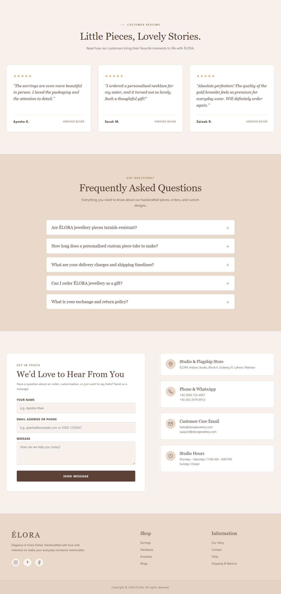

# ÉLORA — Jewellery Website

**ÉLORA** is a modern and elegant jewellery e-commerce website created to showcase beautiful jewellery pieces and make online shopping feel simple, personal, and enjoyable.

The website features thoughtfully designed jewellery collections, product details, and personalized jewellery options, allowing customers to explore pieces that reflect their individual style and personality.

ÉLORA represents more than jewellery. It celebrates individuality, meaningful moments, and the beauty of personal expression. Every piece tells a story, whether it is a gift for someone special or a little something chosen for yourself.

## 🛍️ Website Features

### 1. Home Page
### 2. Shop / Collections
### 3. Product Details
### 4. Personalized Jewellery
### 5. Shopping Cart
### 6. Responsive Design

## 💻 Technologies Used

| Technology | Purpose |
|---|---|
| HTML5 | Website structure |
| CSS3 | Custom styling |
| JavaScript | Interactive features and functionality |
| LocalStorage | Client-side data persistence, where implemented |

## 💖 Brand Message

At ÉLORA, jewellery is more than an accessory. It is a reflection of personality, a memory of special moments, and a story worth wearing.

## ScreenShots

